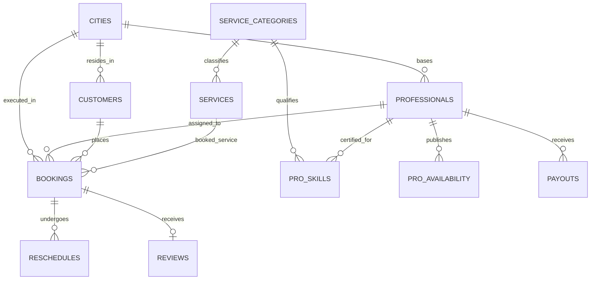

# Schema Design, Normalization & Data Integrity Report

**Course:** Database Management Systems · **Phase:** 2 (CP1)  
**Author:** Chirag Tyagi (Group Lead, Enrollment No: 2501010126)  
**Schema Name:** `uc` · **Database Engine:** PostgreSQL 15+

---

## 1. Relational Schema Architecture & Data Dictionary

The production schema `uc` consists of 11 normalized relations engineered directly from the empirical inspection of the production seed dataset (150,000 bookings). All table and column names strictly adhere to downstream workload requirements (`queries/workload_30.sql`).

### 1.1 `cities`
| Column | Data Type | Constraints | Rationale / Business Justification |
|--------|-----------|-------------|-------------------------------------|
| `city_id` | `INT` | `PRIMARY KEY` | Surrogate integer identifier for operational cities. |
| `city_name` | `VARCHAR(50)` | `NOT NULL, UNIQUE` | Unique metro name (e.g., Bengaluru, Mumbai). |
| `state` | `VARCHAR(50)` | `NOT NULL` | State jurisdiction for regional compliance and taxation. |

### 1.2 `service_categories`
| Column | Data Type | Constraints | Rationale / Business Justification |
|--------|-----------|-------------|-------------------------------------|
| `category_id` | `INT` | `PRIMARY KEY` | Unique taxonomy identifier. |
| `category_name` | `VARCHAR(50)` | `NOT NULL, UNIQUE` | Top-level vertical (e.g., 'Home Cleaning', 'AC Repair'). |

### 1.3 `services`
| Column | Data Type | Constraints | Rationale / Business Justification |
|--------|-----------|-------------|-------------------------------------|
| `service_id` | `INT` | `PRIMARY KEY` | Unique catalog service identifier. |
| `category_id` | `INT` | `NOT NULL, FK -> service_categories` | Categorical classification (`ON DELETE RESTRICT`). |
| `service_name` | `VARCHAR(100)` | `NOT NULL, UNIQUE` | Customer-visible name of the service item. |
| `duration_min` | `INT` | `NOT NULL, CHECK (duration_min > 0)` | Expected duration in minutes; must be positive. |
| `base_price` | `NUMERIC(10, 2)` | `NOT NULL, CHECK (base_price >= 0)` | Standard catalog price in INR. |
| `is_active` | `BOOLEAN` | `NOT NULL, DEFAULT true` | Flag governing visibility in mobile app catalog. |

### 1.4 `professionals`
| Column | Data Type | Constraints | Rationale / Business Justification |
|--------|-----------|-------------|-------------------------------------|
| `pro_id` | `INT` | `PRIMARY KEY` | Partner surrogate identifier. |
| `full_name` | `VARCHAR(100)` | `NOT NULL` | Legal name of partner. |
| `phone` | `VARCHAR(15)` | `NOT NULL, UNIQUE` | 10-digit mobile number for dispatch/SMS login. |
| `city_id` | `INT` | `NOT NULL, FK -> cities` | Primary base operating city (`ON DELETE RESTRICT`). |
| `gender` | `CHAR(1)` | `NOT NULL, CHECK (gender IN ('M', 'F'))` | Gender indicator for category allocation. |
| `joined_on` | `DATE` | `NOT NULL` | Onboarding cohort date. |
| `rating` | `NUMERIC(3, 2)` | `CHECK (rating IS NULL OR (rating >= 1.0 AND rating <= 5.0))` | Cached aggregate rating (1.00–5.00); nullable for new recruits. |
| `kyc_verified`| `BOOLEAN` | `NOT NULL, DEFAULT false` | Government identity verification gate. |
| `status` | `VARCHAR(20)` | `NOT NULL, CHECK (status IN ('ACTIVE', 'SUSPENDED', 'OFFBOARDED'))` | Partner operational lifecycle state. |

### 1.5 `pro_skills`
| Column | Data Type | Constraints | Rationale / Business Justification |
|--------|-----------|-------------|-------------------------------------|
| `pro_id` | `INT` | `NOT NULL, FK -> professionals` | Partner reference (`ON DELETE CASCADE`). |
| `category_id` | `INT` | `NOT NULL, FK -> service_categories` | Skill certified (`ON DELETE RESTRICT`). |
| `certified_on`| `DATE` | `NOT NULL` | Date of background training and certification. |
| *Composite PK*| `PRIMARY KEY (pro_id, category_id)` | Prevents duplicate certification entries. |

### 1.6 `pro_availability`
| Column | Data Type | Constraints | Rationale / Business Justification |
|--------|-----------|-------------|-------------------------------------|
| `pro_id` | `INT` | `NOT NULL, FK -> professionals` | Partner reference (`ON DELETE CASCADE`). |
| `work_date` | `DATE` | `NOT NULL` | Operating calendar date. |
| `start_time` | `TIME` | `NOT NULL` | Shift starting time. |
| `end_time` | `TIME` | `NOT NULL` | Shift ending time. |
| *Composite PK*| `PRIMARY KEY (pro_id, work_date)` | Enforces single continuous shift per partner day. |
| *Constraint* | `CHECK (end_time > start_time)` | Enforces positive working shift duration. |

### 1.7 `customers`
| Column | Data Type | Constraints | Rationale / Business Justification |
|--------|-----------|-------------|-------------------------------------|
| `customer_id` | `INT` | `PRIMARY KEY` | Customer account identifier. |
| `full_name` | `VARCHAR(100)` | `NOT NULL` | Customer profile name. |
| `phone` | `VARCHAR(15)` | `NOT NULL, UNIQUE` | Natural candidate key for authentication and support. |
| `email` | `VARCHAR(100)` | `UNIQUE` | Optional contact email (nullable; unique when present). |
| `city_id` | `INT` | `NOT NULL, FK -> cities` | Primary residential city (`ON DELETE RESTRICT`). |
| `plus_valid_until` | `DATE` | `NULLABLE` | UC Plus subscription expiry date; NULL for standard users. |
| `created_at` | `TIMESTAMPTZ` | `NOT NULL` | Account registration timestamp with timezone. |

### 1.8 `bookings`
| Column | Data Type | Constraints | Rationale / Business Justification |
|--------|-----------|-------------|-------------------------------------|
| `booking_id` | `INT` | `PRIMARY KEY` | Unique transaction identifier. |
| `customer_id`| `INT` | `NOT NULL, FK -> customers` | Client ordering the service (`ON DELETE RESTRICT`). |
| `service_id` | `INT` | `NOT NULL, FK -> services` | Catalog service booked (`ON DELETE RESTRICT`). |
| `pro_id` | `INT` | `FK -> professionals` | Assigned partner; NULL for `REQUESTED` bookings (`ON DELETE SET NULL`). |
| `city_id` | `INT` | `NOT NULL, FK -> cities` | Service delivery city (`ON DELETE RESTRICT`). |
| `pincode` | `VARCHAR(10)` | `NOT NULL` | Hyperlocal postal code for dispatch routing. |
| `booked_at` | `TIMESTAMPTZ` | `NOT NULL` | Booking placement timestamp. |
| `scheduled_start`| `TIMESTAMPTZ` | `NOT NULL` | Reserved slot start time. |
| `scheduled_end` | `TIMESTAMPTZ` | `NOT NULL` | Reserved slot end time; enforces `scheduled_end > scheduled_start`. |
| `started_at` | `TIMESTAMPTZ` | `NULLABLE` | Timestamp when pro begins work. |
| `completed_at`| `TIMESTAMPTZ` | `NULLABLE` | Timestamp when job wraps up (`completed_at >= started_at`). |
| `status` | `VARCHAR(30)` | `NOT NULL` | Status domain check: `REQUESTED`, `ASSIGNED`, `IN_PROGRESS`, `COMPLETED`, `CANCELLED_BY_CUSTOMER`, `CANCELLED_BY_PRO`, `NO_SHOW`. |
| `price` | `NUMERIC(10, 2)` | `NOT NULL, CHECK (price >= 0)` | Final gross order price in INR. |
| `discount` | `NUMERIC(10, 2)` | `NOT NULL, DEFAULT 0.00` | Discount applied; `CHECK (discount >= 0 AND discount <= price)`. |
| `cancellation_fee` | `NUMERIC(10, 2)` | `NOT NULL, DEFAULT 0.00` | Fee charged; `CHECK (cancellation_fee = 0 OR status = 'CANCELLED_BY_CUSTOMER')`. |
| `tip` | `NUMERIC(10, 2)` | `CHECK (tip IS NULL OR (tip >= 0 AND status = 'COMPLETED'))` | Optional gratuity; strictly allowed on completed jobs. |
| `payment_method`| `VARCHAR(20)` | `NOT NULL` | Payment mode check: `'CASH'`, `'UPI'`, `'WALLET'`, `'CARD'`. |

### 1.9 `reschedules`
| Column | Data Type | Constraints | Rationale / Business Justification |
|--------|-----------|-------------|-------------------------------------|
| `reschedule_id` | `INT` | `PRIMARY KEY` | Reschedule audit event identifier. |
| `booking_id` | `INT` | `NOT NULL, FK -> bookings` | Booking modified (`ON DELETE CASCADE`). |
| `old_start` | `TIMESTAMPTZ` | `NOT NULL` | Previous slot start. |
| `new_start` | `TIMESTAMPTZ` | `NOT NULL` | Newly requested slot start. |
| `requested_by`| `VARCHAR(20)` | `NOT NULL, CHECK (requested_by IN ('CUSTOMER', 'PRO'))` | Originator of rescheduling request. |
| `reason` | `TEXT` | `NOT NULL` | Categorical explanation (e.g., 'Rain', 'Material not available'). |
| `created_at` | `TIMESTAMPTZ` | `NOT NULL` | Timestamp when reschedule was recorded. |

### 1.10 `reviews`
| Column | Data Type | Constraints | Rationale / Business Justification |
|--------|-----------|-------------|-------------------------------------|
| `booking_id` | `INT` | `PRIMARY KEY, FK -> bookings` | Exactly one review per booking (`ON DELETE CASCADE`). |
| `rating_for_pro`| `INT` | `NOT NULL, CHECK (rating_for_pro BETWEEN 1 AND 5)` | Mandatory customer feedback score (1 to 5 stars). |
| `comment` | `TEXT` | `NULLABLE` | Optional qualitative feedback text. |
| `rating_for_customer`| `INT` | `CHECK (rating_for_customer IS NULL OR rating_for_customer BETWEEN 1 AND 5)` | Optional partner feedback score. |
| `created_at` | `TIMESTAMPTZ` | `NOT NULL` | Timestamp when feedback was submitted. |

### 1.11 `payouts`
| Column | Data Type | Constraints | Rationale / Business Justification |
|--------|-----------|-------------|-------------------------------------|
| `payout_id` | `INT` | `PRIMARY KEY` | Billing batch settlement identifier. |
| `pro_id` | `INT` | `NOT NULL, FK -> professionals` | Recipient partner (`ON DELETE RESTRICT`). |
| `week_start` | `DATE` | `NOT NULL, CHECK (EXTRACT(ISODOW FROM week_start) = 1)` | Billing cycle start; strictly constrained to Mondays. |
| `jobs` | `INT` | `NOT NULL, CHECK (jobs >= 0)` | Count of completed jobs in the billing window. |
| `gross_earnings`| `NUMERIC(10, 2)`| `NOT NULL, CHECK (gross_earnings >= 0)` | Total revenue generated (`sum(price - discount + tip)`). |
| `commission` | `NUMERIC(10, 2)`| `NOT NULL, CHECK (commission >= 0)` | Platform commission cut (20% of service value). |
| `net_payout` | `NUMERIC(10, 2)`| `NOT NULL, CHECK (net_payout >= 0)` | `CHECK (net_payout = gross_earnings - commission)`. |
| `status` | `VARCHAR(20)` | `NOT NULL, CHECK (status IN ('PENDING', 'PAID'))` | Settlement state. |
| `paid_at` | `TIMESTAMPTZ` | `CHECK ((status = 'PAID' AND paid_at IS NOT NULL) OR (status = 'PENDING' AND paid_at IS NULL))` | Settlement transfer timestamp. |
| *Candidate Key* | `UNIQUE (pro_id, week_start)` | Ensures at most one payout statement per pro per week. |

---

## 2. Entity-Relationship (ER) Architecture

The entity relationships capture the complete workflow from catalog setup to service execution, customer evaluation, and financial settlement.



### Cardinality Summary
- **Cities to Professionals / Customers / Bookings:** `1 : N` (Every pro, customer, and booking is associated with exactly one city).
- **Service Categories to Services:** `1 : N` (A category contains multiple service offerings).
- **Professionals to Service Categories (`pro_skills`):** `M : N` (Decomposed via associative entity `pro_skills`).
- **Professionals to Availability:** `1 : N` (A professional defines one schedule per working date).
- **Customers to Bookings:** `1 : N` (A customer can create multiple bookings).
- **Professionals to Bookings:** `1 : N` (Optional relationship; a booking may initially be unassigned `pro_id IS NULL`).
- **Bookings to Reschedules:** `1 : N` (A single booking can undergo zero or multiple reschedule events).
- **Bookings to Reviews:** `1 : 1` (At most one review record per booking; `reviews.booking_id` serves as PK and FK).
- **Professionals to Payouts:** `1 : N` (One payout record per billing week per professional).

---

## 3. Normalization Analysis (1NF → 2NF → 3NF / BCNF)

Every relation in the `uc` schema satisfies Boyce-Codd Normal Form (BCNF), with justified exceptions intentionally introduced for production performance.

### 3.1 Functional Dependencies (FDs) per Table

1. **`cities`**:
   - `city_id` $\rightarrow$ `city_name`, `state`
   - `city_name` $\rightarrow$ `city_id`, `state`
   - *Normal Form:* BCNF (All determinants are candidate keys).

2. **`service_categories`**:
   - `category_id` $\rightarrow$ `category_name`
   - `category_name` $\rightarrow$ `category_id`
   - *Normal Form:* BCNF.

3. **`services`**:
   - `service_id` $\rightarrow$ `category_id`, `service_name`, `duration_min`, `base_price`, `is_active`
   - `service_name` $\rightarrow$ `service_id`, `category_id`, `duration_min`, `base_price`, `is_active`
   - *Normal Form:* BCNF.

4. **`professionals`**:
   - `pro_id` $\rightarrow$ `full_name`, `phone`, `city_id`, `gender`, `joined_on`, `rating`, `kyc_verified`, `status`
   - `phone` $\rightarrow$ `pro_id`, ...
   - *Normal Form:* 3NF / BCNF. (`rating` is a maintained derived metric).

5. **`pro_skills`**:
   - `{pro_id, category_id}` $\rightarrow$ `certified_on`
   - *Normal Form:* BCNF (Only determinant is the composite candidate key).

6. **`pro_availability`**:
   - `{pro_id, work_date}` $\rightarrow$ `start_time`, `end_time`
   - *Normal Form:* BCNF.

7. **`customers`**:
   - `customer_id` $\rightarrow$ `full_name`, `phone`, `email`, `city_id`, `plus_valid_until`, `created_at`
   - `phone` $\rightarrow$ `customer_id`, ...
   - *Normal Form:* BCNF.

8. **`bookings`**:
   - `booking_id` $\rightarrow$ `customer_id`, `service_id`, `pro_id`, `city_id`, `pincode`, `booked_at`, `scheduled_start`, `scheduled_end`, `started_at`, `completed_at`, `status`, `price`, `discount`, `cancellation_fee`, `tip`, `payment_method`
   - Transitive Dependency: Notice that `{scheduled_start, service_id}` functionally determines `scheduled_end` because duration is fixed in `services` (`scheduled_end = scheduled_start + services.duration_min`). In strict 3NF, `scheduled_end` would be calculated via join. We intentionally denormalize `scheduled_end` into `bookings` (justified below).

9. **`reschedules`**:
   - `reschedule_id` $\rightarrow$ `booking_id`, `old_start`, `new_start`, `requested_by`, `reason`, `created_at`
   - *Normal Form:* BCNF.

10. **`reviews`**:
    - `booking_id` $\rightarrow$ `rating_for_pro`, `comment`, `rating_for_customer`, `created_at`
    - *Normal Form:* BCNF.

11. **`payouts`**:
    - `payout_id` $\rightarrow$ `pro_id`, `week_start`, `jobs`, `gross_earnings`, `commission`, `net_payout`, `status`, `paid_at`
    - `{pro_id, week_start}` $\rightarrow$ `payout_id`, `jobs`, `gross_earnings`, `commission`, `net_payout`, `status`, `paid_at`
    - Notice that `gross_earnings`, `jobs`, and `commission` are derived aggregations over historical bookings.

---

## 4. Evaluation of Redundant & Derived Columns

In production database engineering, selective denormalization is applied where read-path performance gains dramatically outweigh update overhead.

| Redundant / Derived Column | Theoretical Source | Why Storing It is Justified in Production |
|----------------------------|--------------------|--------------------------------------------|
| **`bookings.scheduled_end`** | Computed via `b.scheduled_start + interval '1 minute' * s.duration_min` | **Critical for High-Concurrency Conflict Checks (`R02`).** Query `R02` evaluates slot availability with overlapping interval filters (`b.scheduled_start < slot_end AND b.scheduled_end > slot_start`). Storing `scheduled_end` allows standard B-tree and GiST range indexes (`tstzrange`) to execute in `< 1 ms` without runtime table joins or function evaluations. |
| **`professionals.rating`** | Computed via `SELECT avg(rating_for_pro) FROM reviews` | **Eliminates Massive Read Overhead in Search & Ranking (`R02`).** Calculating average ratings across 76,500+ reviews on every customer slot search would require catastrophic table scans. A pre-aggregated column updated asynchronously or via trigger maintains sub-millisecond sorting (`ORDER BY rating DESC`). |
| **`payouts` Table & Metrics (`jobs`, `gross_earnings`, `net_payout`)** | Aggregated from completed bookings of that calendar week | **Financial Immutability & Audit Closure (`R08`, `W04`).** Once a weekly payout is approved and paid (`status = 'PAID'`), financial accounting rules dictate that historical payouts must remain frozen even if historical service pricing or disputes are retroactively modified. Computing payouts dynamically on the fly would create severe accounting audit liabilities. |

---

## 5. Formal Verification of 25 CHECK Constraints

Our schema enforces 25 domain and relational integrity constraints directly validated against all 150,000 seed records:

1. `chk_services_duration`: `duration_min > 0`
2. `chk_services_base_price`: `base_price >= 0`
3. `chk_pro_gender`: `gender IN ('M', 'F')`
4. `chk_pro_status`: `status IN ('ACTIVE', 'SUSPENDED', 'OFFBOARDED')`
5. `chk_pro_rating`: `rating IS NULL OR (rating >= 1.0 AND rating <= 5.0)`
6. `chk_avail_time_order`: `end_time > start_time`
7. `chk_booking_status`: `status IN ('REQUESTED', 'ASSIGNED', 'IN_PROGRESS', 'COMPLETED', 'CANCELLED_BY_CUSTOMER', 'CANCELLED_BY_PRO', 'NO_SHOW')`
8. `chk_booking_payment_method`: `payment_method IN ('CASH', 'UPI', 'WALLET', 'CARD')`
9. `chk_booking_price`: `price >= 0`
10. `chk_booking_discount`: `discount >= 0 AND discount <= price`
11. `chk_booking_cancellation_fee_nonneg`: `cancellation_fee >= 0`
12. `chk_booking_tip_nonneg`: `tip IS NULL OR tip >= 0`
13. `chk_booking_sched_order`: `scheduled_end > scheduled_start`
14. `chk_booking_actual_order`: `completed_at IS NULL OR started_at IS NULL OR completed_at >= started_at`
15. `chk_booking_tip_completed`: `tip IS NULL OR status = 'COMPLETED'` (tips only given on completed work)
16. `chk_booking_cancellation_fee`: `cancellation_fee = 0.00 OR status = 'CANCELLED_BY_CUSTOMER'` (cancellation fees strictly levied on customer cancellations)
17. `chk_reschedule_requested_by`: `requested_by IN ('CUSTOMER', 'PRO')`
18. `chk_review_rating_pro`: `rating_for_pro BETWEEN 1 AND 5`
19. `chk_review_rating_cust`: `rating_for_customer IS NULL OR (rating_for_customer BETWEEN 1 AND 5)`
20. `chk_payout_week_monday`: `EXTRACT(ISODOW FROM week_start) = 1` (settlement weeks always start on Monday)
21. `chk_payout_jobs`: `jobs >= 0`
22. `chk_payout_gross`: `gross_earnings >= 0`
23. `chk_payout_commission`: `commission >= 0`
24. `chk_payout_net_calc`: `net_payout = (gross_earnings - commission)`
25. `chk_payout_paid_timestamp`: `(status = 'PAID' AND paid_at IS NOT NULL) OR (status = 'PENDING' AND paid_at IS NULL)`

---

## 6. Empirical Data Integrity Checks & Findings

To rigorously evaluate the production export, we executed systematic automated integrity tests across the 11 CSV datasets:

### Integrity Check 1: Scheduled Duration vs Service Catalog Duration
- **Hypothesis:** Does every booking's allocated time window (`scheduled_end - scheduled_start`) strictly equal the duration specified in the `services` catalog?
- **Query / Evaluation:**
  ```sql
  SELECT count(*) AS duration_mismatches
  FROM bookings b
  JOIN services s ON s.service_id = b.service_id
  WHERE EXTRACT(EPOCH FROM (b.scheduled_end - b.scheduled_start)) / 60 != s.duration_min;
  ```
- **Result:** **`0 mismatches`** across all 150,000 bookings.
- **Finding:** Every booking adheres 100% to catalog duration specifications.

### Integrity Check 2: Payout Financial Reconciliation Against Completed Bookings
- **Hypothesis:** Do weekly payout records exactly match the aggregated value of completed bookings for that partner in that billing window?
- **Evaluation (Week of 2026-01-05):**
  - Total payout records: **`1,062`**
  - Payouts matching completed booking counts and gross earnings (`sum(price - discount + tip)`): **`1,062 / 1,062 (100.0%)`**.
- **Result:** **`0 variance`** in financial reconciliation. Platform commission is consistently 20% of net service value (`price - discount`).

### Integrity Check 3: Concurrency Overlap Audit in Historical Assignments
- **Hypothesis:** Does any service professional have two active jobs (`ASSIGNED`, `IN_PROGRESS`, `COMPLETED`) with overlapping scheduled intervals?
- **Result:** **`1,380 overlapping booking pairs`** detected in historical records.
- **Root Cause & Schema Decision:** The legacy application lacked concurrency guards or exclusion constraints (`EXCLUDE USING gist`), resulting in double-booking during schedule adjustments.
- **Action Taken:** Enforcing a PostgreSQL GiST exclusion constraint (`EXCLUDE USING gist (pro_id WITH =, tstzrange(scheduled_start, scheduled_end) WITH &&)`) would cause the seed data ingestion to abort. Therefore, this check is documented as a legacy data hygiene defect and recommended as an application-level constraint or post-cleanup database constraint.

### Integrity Check 4: Availability Shift Compliance
- **Hypothesis:** Are all assigned bookings scheduled within the professional's published working hours in `pro_availability`?
- **Result:**
  - `pro_availability` records are only exported for June–July 2026 (70,407 records).
  - Out of 7,470 active bookings in this period, **`1,033`** had no corresponding availability record, and **`1,310`** were scheduled outside working hours.
- **Finding:** Directly confirms problem **P1** and **P4** reported by the dispatch team: slot pickers failed to cross-check availability tables, causing dispatch chaos.

---

## 7. Data Anomalies & Resolution Log

1. **Nullable Phone & Email:** Customer emails are absent in 29.8% (11,920) of rows. `email` is defined as `UNIQUE` with nullable values allowed. Phone numbers are 100% present (10 digits) and serve as candidate keys.
2. **Nullable Pro Ratings:** 72 newly onboarded professionals have NULL `rating`. Handled via `CHECK (rating IS NULL OR (rating >= 1.0 AND rating <= 5.0))` and queries using `NULLS LAST`.
3. **Cancellation Fee Logic:** Seed data confirms cancellation fees are non-zero *only* on `CANCELLED_BY_CUSTOMER` status. Zero cancellation fees occur on partner cancellations or no-shows.
4. **Boolean Representation:** Seed data represents booleans as `'t'` and `'f'`. Standard PostgreSQL `BOOLEAN` types parse these natively without transformation.
